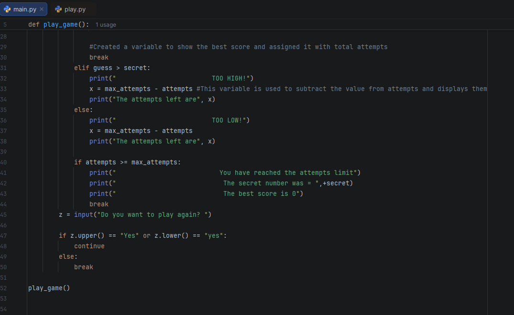

# Number Guessing Game (Python)

My first real Python project. The computer picks a secret number, and you try to guess it before your attempts run out.

## Features
- Rejects letters and out-of-range numbers without using an attempt
- "TOO HIGH" and "TOO LOW" hints
- Limited attempts, with a countdown after each guess
- Best score tracking
- Play again option

## Files
- `main.py`: my original terminal version. All the game logic is mine.
- `play.py`: the same game with a web interface. The interface was built with help from Claude (Anthropic) and runs my game code unchanged.

## How to run
1. Install Python 3.
2. Download `play.py`.
3. Run `python play.py`. The game opens in your browser.

For the terminal version, run `python main.py`.

## What I learned
- Loops, `break` and `continue`
- Indentation and code blocks
- `try` / `except` for bad input
- Variable scope inside functions

Feedback on how to improve is very welcome!
